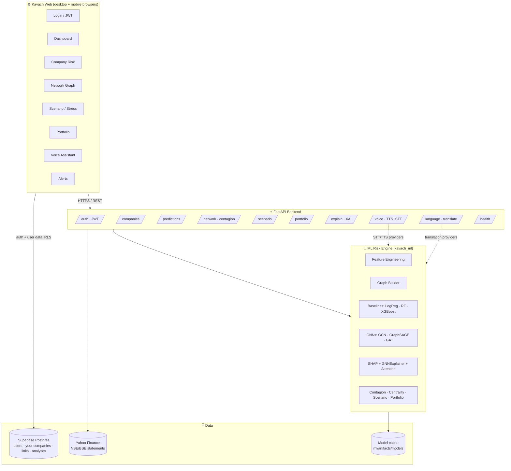
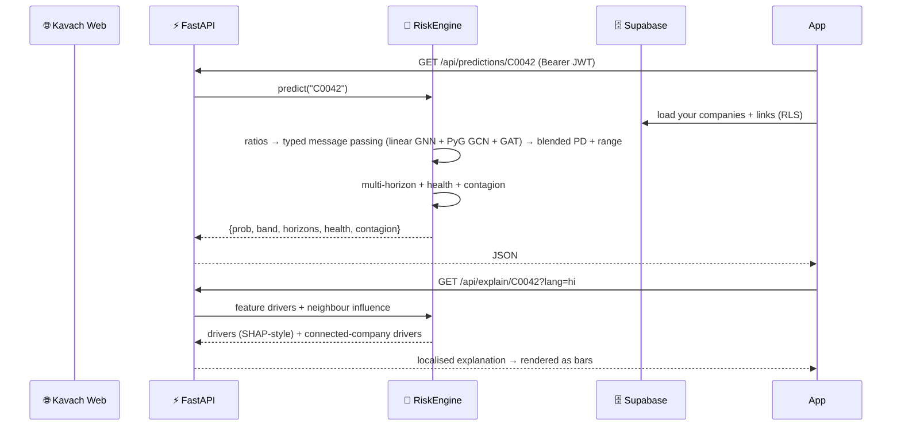

<div align="center">

# 🛡️ Kavach

### Graph Neural Network Corporate Financial Risk Intelligence Platform

*A web-first corporate risk intelligence platform — read the network, not just the balance sheet.*


</div>

---

## 📖 Table of contents

1. [What Kavach is](#-what-kavach-is)
2. [The core idea in one picture](#-the-core-idea-in-one-picture)
3. [Why a Graph Neural Network](#-why-a-graph-neural-network-not-just-xgboost)
4. [System architecture](#-system-architecture)
5. [Complete feature set (25 modules + voice + multilingual)](#-complete-feature-set)
6. [Tech stack](#-tech-stack)
7. [End-to-end request flow](#-end-to-end-request-flow)
8. [The ML experiment & results](#-the-ml-experiment--results)
9. [Repository layout](#-repository-layout)
10. [Quick start](#-quick-start-5-minutes)
11. [API reference](#-api-reference)
12. [Deployment](#-deployment)
13. [Roadmap](#-roadmap)
14. [Honest scope & disclaimers](#-honest-scope--disclaimers)

---

## 🎯 What Kavach is

**Kavach** (Sanskrit for *shield / armour*) is a production-shaped **Corporate Financial
Risk Intelligence Platform**. It forecasts whether a company is heading toward
**financial distress** — the state before *default → restructuring → insolvency →
bankruptcy* — and, crucially, it does so by modelling the **web of relationships**
each company sits inside: its suppliers, customers, subsidiaries, lenders and
industry peers.

It is not "a GNN notebook". It is a full vertical slice:

> a **responsive web client** → a **FastAPI backend** → a **Graph Neural Network** engine →
> **Supabase** (Postgres + auth, row-level security) for user data, with **explainable AI**, **scenario stress
> testing**, **network-contagion simulation**, a **multilingual voice assistant**, Docker
> packaging and CI/CD.

Think of it as a browser-based credit-risk terminal, built for analysts who need
room to explore company fundamentals, portfolios, scenarios, and network graphs.

---

## 🖼️ The core idea in one picture

A company can look perfectly healthy on its own books and still fail — because the
supplier it depends on for 48% of its raw materials is collapsing, or its biggest
customer just defaulted. **Balance-sheet models are blind to this. Kavach is not.**

```
                        Supplier A  🔴 (distressed)
                             │ 48% of purchases
                             ▼
   Supplier B 🟢 ─────▶  COMPANY X  🟠 ◀───── Customer C 🟢
                             │
                             ▼
                       Subsidiary D 🔴 (high debt)
                             │
                             ▼
                          Bank E  (rising exposure)
```

Company X's own ratios say "fine". Its **neighbourhood** says "danger". A Graph
Neural Network passes messages along these edges, so X's risk score is informed by
everything it is connected to.

---

## 🧠 Why a Graph Neural Network (not just XGBoost)?

| | Tabular model (XGBoost / LogReg) | **Graph Neural Network (Kavach)** |
|---|---|---|
| Sees a company's own financials | ✅ | ✅ |
| Sees its suppliers' / customers' health | ❌ | ✅ (message passing) |
| Detects contagion / cascading failure | ❌ | ✅ |
| Catches a *healthy-looking* firm dragged down by its network | ❌ | ✅ |
| Explains *which connected company* drove the risk | ❌ | ✅ (attention / GNNExplainer) |

Kavach trains **both** and puts them on the same scoreboard, so the graph advantage
is measured, not asserted. See [results](#-the-ml-experiment--results).

It goes further than a plain GCN: because corporate edges are not interchangeable
(a supplier link ≠ an ownership stake), Kavach models the graph as **heterogeneous**
with a **relational GNN (R-GCN-style)** that learns a separate transformation per
relation type, and a **hybrid GNN + gradient-boosting ensemble** — the two
architectures the 2024–2026 literature identifies as state of the art for corporate
distress/credit-default prediction. Every design choice is traced to a paper in
**[docs/RESEARCH.md](docs/RESEARCH.md)** (R-GCN, HGT, GraphSAGE, GAT, focal loss,
GNNExplainer, GraphSMOTE, HGNN-EBP 2025, relational-GNN+ensemble 2026, dynamic
guarantee-network GNN 2026, and the standard Polish / Taiwanese / American
benchmark datasets).

**Message passing, plainly:** each company starts with its own feature vector; at
every GNN layer it *aggregates* its neighbours' vectors and updates its own. After a
couple of layers, each company's representation encodes its 1–2 hop financial
neighbourhood. A classifier head turns that into a distress probability.

---

## 🏛️ System architecture



**Layered, thin-controller design:** route handlers stay thin and delegate to the
`RiskEngine`, which owns all modelling and graph analytics. **The API is stateless**:
your companies, fiscal years and relationships live in Supabase (row-level security,
see `supabase/schema.sql`) and are sent with each scoring request, so the same engine
scores the simulated universe and your own workspace. Trained networks are cached on
disk, so restarts load them instead of retraining and scores are reproducible.

---

## 🚀 Complete feature set

Kavach is built around the core GNN prediction plus **25 intelligence modules** and two
cross-cutting product pillars — **voice** and **multilingual** support.

### Core prediction
| # | Feature | What it does | Endpoint |
|---|---|---|---|
| 1 | **Financial Distress Score** | GNN probability of distress within 12 months | `GET /api/predictions/{id}` |
| 2 | **Multi-Horizon Prediction** | Separate risk at **3 / 6 / 12 / 24 months** | `.../multi-horizon` |
| 3 | **Financial Health Score** | 0–100 composite of liquidity, leverage, profitability, cash flow, growth | `.../health-score` |
| 4 | **Risk Banding** | LOW · MODERATE · HIGH · CRITICAL | every prediction |

### Fundamental risk modules
| # | Feature | Signals |
|---|---|---|
| 5 | **Liquidity Risk** | current / quick / cash ratio, working capital |
| 6 | **Leverage Risk** | debt/equity, debt/assets, interest coverage, net-debt/EBITDA |
| 7 | **Profitability Trend** | multi-year margin trajectory, not just latest |
| 8 | **Cash-Flow Risk** | OCF, FCF, cash-flow volatility, cash burn (months of runway) |
| 9 | **Revenue Growth** | YoY, 3-yr CAGR, acceleration / deceleration |
| 10 | **Anomaly Detection** | flags abrupt YoY jumps in revenue / debt / cash |

### Network / graph intelligence 🔥
| # | Feature | What it does | Endpoint |
|---|---|---|---|
| 11 | **Network Contagion Risk** | how exposed a firm is to distressed neighbours | `GET /api/network/{id}/contagion` |
| 12 | **Supplier Concentration** | Herfindahl-Hirschman index over suppliers | company detail |
| 13 | **Customer Concentration** | HHI over customers | company detail |
| 14 | **Dependency Risk** | reliance on suppliers / customers / banks / subsidiaries | company detail |
| 15 | **Centrality Risk** | PageRank + degree centrality (systemic importance) | company detail |
| 16 | **Community / Cluster Risk** | risk of the surrounding industry cluster | heatmap |
| 17 | **Industry Risk** | industry-level average risk + heatmap | `GET /api/network/heatmap` |
| 18 | **What-if Network Simulation** | propagate a supplier failure downstream (BFS + decay) | `POST /api/network/{id}/simulate-failure` |

### Product & decision-support
| # | Feature | What it does | Endpoint |
|---|---|---|---|
| 19 | **Scenario Analysis / Stress Test** | recompute risk under revenue drop / rate hike / supplier loss | `POST /api/scenario` |
| 20 | **Explainable AI** | signed feature drivers **+ which connected companies** drove the score | `GET /api/explain/{id}` |
| 21 | **Risk Timeline** | back-cast how a company's risk evolved year over year | company detail |
| 22 | **Peer Comparison** | company vs. industry average across key metrics | company detail |
| 23 | **Early-Warning System** | feed of companies that crossed into HIGH/CRITICAL | `GET /api/alerts/early-warning` |
| 24 | **Risk Heatmap** | industry-by-industry risk colour map | `GET /api/network/heatmap` |
| 25 | **Portfolio Risk** | aggregate distress exposure **+ shared-network concentration** | `POST /api/portfolio/risk` |

### 🎙️ Voice (audio) — cross-cutting pillar
- **Text-to-Speech**: risk summaries read aloud — `POST /api/voice/tts`
- **Speech-to-Text**: dictate a query — `POST /api/voice/stt`
- **Full voice loop**: *speak a question → transcribe → answer → speak the answer* — `POST /api/voice/ask`
- Browser speech recognition and text-to-speech where supported, with the
  server-side voice pipeline available as well. Providers are pluggable (stub /
  gTTS / Whisper / Azure / Google); microphone access requires browser permission
  and a secure HTTPS origin.

### 🌐 Multilingual — cross-cutting pillar
- **12 Indian languages** out of the box: English, हिन्दी, বাংলা, தமிழ், తెలుగు, मराठी, ગુજરાતી, ಕನ್ನಡ, മലയാളം, ਪੰਜਾਬੀ, ଓଡ଼ିଆ, অসমীয়া — `GET /api/language/supported`
- Translate any risk explanation / alert — `POST /api/language/translate`
- Web UI localised via the Flutter language tables; explanations localised at the API.
- Provider-pluggable (builtin offline glossary / deep-translator / Azure).

---

## 🧰 Tech stack

| Layer | Technology |
|---|---|
| **Web client** | Flutter Web · Dart · Provider · Dio · fl_chart · speech_to_text · flutter_tts |
| **Backend** | Python · FastAPI · Pydantic · Uvicorn · JWT (python-jose) |
| **ML core** | PyTorch · **PyTorch Geometric** · scikit-learn · XGBoost / LightGBM |
| **GNN models** | GCN · GraphSAGE · GAT · **R-GCN (relational)** · **Hybrid GNN+GBDT** · Altman Z-Score baseline |
| **Explainability** | SHAP · GNNExplainer / PGExplainer · GAT attention |
| **Graph algorithms** | PageRank · degree centrality · HHI concentration · Louvain community |
| **Data** | Supabase (Postgres + auth + RLS) · Yahoo Finance (NSE/BSE statements) |
| **Infra** | Docker · docker-compose · GitHub Actions CI · Render |

---

## 🔄 End-to-end request flow

*Example: analyst opens Company X on their phone.*



---

## 📊 The ML experiment & results

**Protocol:** 5-fold stratified cross-validation on the simulated universe
(1,500 companies, ~10% default rate). Inside every fold, 18% of the training part is
held out for early stopping and calibration. Graph models that use counterparties'
*known default status* only see labels from the training part of the fold; test
companies' labels are hidden. Reproduce with `python ml/scripts/benchmark.py`
(writes `ml/artifacts/benchmark.json` / `.md`). Mean ± std over folds:

| Model | ROC-AUC | PR-AUC | Brier |

|---|---|---|---|

| Blend: linear relational GNN + GCN + GAT | 0.784 ± 0.032 | 0.442 ± 0.093 | 0.0745 |

| PyG GCN + counterparty defaults | 0.782 ± 0.031 | 0.441 ± 0.078 | 0.0757 |

| Linear relational GNN + counterparty defaults | 0.780 ± 0.042 | 0.428 ± 0.117 | 0.0761 |

| PyG GAT + counterparty defaults | 0.765 ± 0.035 | 0.443 ± 0.074 | 0.0756 |

| Linear relational GNN, ratios only | 0.762 ± 0.033 | 0.409 ± 0.105 | 0.0779 |

| Logistic regression, own ratios | 0.749 ± 0.023 | 0.416 ± 0.067 | 0.0765 |

| PyG R-GCN + counterparty defaults | 0.738 ± 0.034 | 0.414 ± 0.097 | 0.0807 |

| Altman Z-score (1968) | 0.730 ± 0.031 | 0.359 ± 0.069 | 0.2225 |

**Honest reading**

- **The production model is the blend** of the linear relational GNN, a PyTorch
  Geometric GCN and a PyG GAT (log-odds average). It has the best calibration (Brier)
  and ties for the best ranking. The gaps between the top four rows are **within
  fold-to-fold noise** (± 0.03 AUC); none of them is clearly better than the others.
- **The graph signal is real but moderate**: the best graph models beat ratios-only
  logistic regression by about 0.035 AUC. Most of the lift comes from counterparties'
  *known default status* (an input lenders genuinely have: IBC admissions and D
  ratings are public), which every graph model here uses.
- **The PyG R-GCN underperforms** at this scale: per-relation weight matrices
  overfit 1,500 nodes. It stays in the benchmark rather than being hidden.
- **Altman Z (1968)** ranks reasonably but is badly calibrated (Brier 0.22), so it is
  unusable as a probability.
- An earlier version of this README reported ~0.99 ROC-AUC. That came from an older
  synthetic generator whose labels were far too easy and from a single lucky split;
  it has been replaced by the cross-validated numbers above.

**Uncertainty.** Every score carries a model range: the 10th–90th percentile across
all individual networks (5 seeds × 2 PyG architectures + the linear model).
**Multi-horizon risk** (3/6/24 months) is *derived* from the 12-month PD with a
hazard curve; only the 12-month PD is predicted. The UI says so.

---

## 🗂️ Repository layout

```
Kavach/
├── README.md                    ← you are here
├── docs/
│   ├── ARCHITECTURE.md          ← deep architecture document (every subsystem, diagrams, Q&A)
│   ├── RESEARCH.md              ← literature review: every design choice traced to a paper
│   └── Kavach_Architecture_Guide.pdf
├── ml/                          ← Graph ML engine
│   ├── src/kavach_ml/
│   │   ├── data/                synthetic economy · features · typed-edge graph builder
│   │   ├── models/              altman · baselines · GCN/GraphSAGE/GAT/R-GCN · relational + hybrid numpy GNN
│   │   ├── explain/             SHAP + GNNExplainer + neighbour influence
│   │   ├── serve/engine.py      RiskEngine (all analytics used by the API)
│   │   ├── train.py evaluate.py config.py utils.py
│   ├── scripts/                 quick_demo.py · run_pipeline.py
│   └── tests/
├── backend/                     ← FastAPI service
│   ├── app/
│   │   ├── routers/             auth companies predictions network scenario
│   │   │                        portfolio alerts explain language voice ml health
│   │   ├── services/            ingest (ticker · CSV/Excel · PDF) · assistant · audio · translation
│   │   ├── core/                config · security(JWT) · ml bridge
│   │   └── main.py
│   ├── Dockerfile · tests/
├── mobile/                      ← Flutter web client (historical directory name)
│   ├── lib/ (screens · widgets · services · state · l10n · theme)
│   └── pubspec.yaml
├── supabase/schema.sql         ← tables + row-level security (run once in Supabase)
├── .github/workflows/ci.yml     ← ML + backend + docker + flutter jobs
├── docker-compose.yml · render.yaml · scripts/deploy.sh
```

---

## ⚡ Quick start (5 minutes)

### 1. Run the ML pipeline (NumPy-only, runs anywhere)
```bash
cd ml
pip install numpy pandas scikit-learn
python scripts/quick_demo.py          # prints the model scoreboard
```

### 2. Run the API
```bash
cd backend
pip install -r requirements.txt
uvicorn app.main:app --reload --port 8010
# open http://localhost:8010/docs   (interactive Swagger UI)
# demo login → email: demo@kavach.ai   password: demo1234
```

### 3. Run the API with Docker
```bash
docker compose up --build
```

### 4. Run the web application
```bash
cd mobile
flutter pub get
flutter run -d chrome --dart-define=KAVACH_API_BASE=http://localhost:8010
```

### Use your own companies (real data)
**My companies** is the first screen after sign-in. Four ways in, all ending in a review step:

| Input | How | API |
|---|---|---|
| Spreadsheet | CSV / Excel, one row per company per fiscal year (₹ crore); optional `relationships` sheet (company, counterparty, relation, share, health); optional `defaulted` column | `POST /api/analyze/batch`, `POST /api/ingest/table` |
| Ticker | NSE / BSE symbol → 4–5 years of statements from Yahoo Finance, converted to INR at each balance-sheet date | `GET /api/ingest/ticker/{symbol}` |
| Annual report | PDF → Ind AS line items extracted with the matched line shown for every number | `POST /api/ingest/pdf` |
| Manual | 13 statement fields | `POST /api/analyze` |

Companies you upload are scored **together as one network**: a counterparty that is
also in your list links to its real financials (and its default status, if you mark
it), every fiscal year is scored for a trend line, and a contagion pass shows which of
your companies would drag the others down. Mark known outcomes and press **Retrain**
to mix them into training (the interpretable member retrains per request; with 8+
labels a leave-one-out check is reported). Any company report exports to PDF.
Template: `GET /api/ingest/template.csv`.

### 5. Accounts with Supabase (optional)
1. Create a Supabase project, open **SQL Editor**, paste [`supabase/schema.sql`](supabase/schema.sql) and run it.
   It creates `profiles`, `watchlist`, `portfolios`, `portfolio_holdings`, `analyses` and
   `assistant_queries`, all with owner-only row-level security.
2. Copy the project URL and anon/publishable key from **Project Settings → API**, then run:
```bash
flutter run -d chrome \
  --dart-define=KAVACH_API_BASE=http://localhost:8010 \
  --dart-define=SUPABASE_URL=https://<project>.supabase.co \
  --dart-define=SUPABASE_ANON_KEY=<anon-key>
```
Without these two values the app falls back to the backend's demo login
(`demo@kavach.ai` / `demo1234`) and keeps watchlists and portfolios in browser storage.

**Languages:** the UI ships in English plus all 22 languages of the Eighth Schedule
(Urdu, Kashmiri and Sindhi render right-to-left). Translations for the lower-resource
languages (Bodo, Dogri, Santali, Manipuri, Kashmiri, Sindhi, Sanskrit, Konkani, Maithili)
should be reviewed by native speakers before production use.

---

## 📡 API reference

| Group | Method & path |
|---|---|
| Auth | `POST /api/auth/register` · `POST /api/auth/login` |
| Companies | `GET /api/companies` · `GET /api/companies/search?q=` · `GET /api/companies/{id}` |
| Predictions | `GET /api/predictions/{id}` · `.../multi-horizon` · `.../health-score` |
| Network | `GET /api/network/{id}/graph` · `.../contagion` · `POST .../simulate-failure` · `GET /api/network/heatmap` |
| Scenario | `POST /api/scenario` · `GET /api/scenario/{id}/sweep` |
| Portfolio | `POST /api/portfolio/risk` |
| Explain | `GET /api/explain/{id}?lang=` |
| Alerts | `GET /api/alerts/early-warning` |
| Language | `GET /api/language/supported` · `POST /api/language/translate` |
| Voice | `POST /api/voice/tts` · `POST /api/voice/stt` · `POST /api/voice/ask` |
| ML | `GET /api/ml/model-comparison` · `GET /api/ml/dataset-summary` |
| Health | `GET /api/health` |

Full interactive docs are auto-generated at **`/docs`** (Swagger) and **`/redoc`**.

---

## 🚢 Deployment

**Backend (Render, one click):** `render.yaml` provisions the Docker web service with a
health check at `/api/health`. User data lives in Supabase, so no database is attached.

**Anywhere with Docker:**
```bash
./scripts/deploy.sh image                 # build kavach-api:latest
./scripts/deploy.sh push <your-registry>  # push
```

**Web application + API (Render):** `render.yaml` provisions one Docker service.
The image builds the Flutter web client and serves it from the FastAPI service at
`/`; API routes remain under `/api`. The web client uses the same origin, so no
separate CORS or production API URL configuration is required.

To publish, connect this GitHub repository to Render and deploy its Blueprint
(`render.yaml`). Render assigns the public `onrender.com` URL after deployment;
add that verified URL here and in the GitHub repository's website field once the
service is live. Do not treat a predicted service name as a live deployment link.

**Optional Android build:** the existing target can still be packaged, but the
web application is the primary product:
```bash
cd mobile
flutter build apk --release --dart-define=KAVACH_API_BASE=https://your-api.example.com
```

**CI/CD:** every push runs GitHub Actions — ML tests + model comparison, backend API
tests, backend Docker build, and Flutter analyze. See `.github/workflows/ci.yml`.

Full step-by-step deployment (including managed DB setup and env vars) is in
[`docs/ARCHITECTURE.md`](docs/ARCHITECTURE.md#18-deployment).

---

## 🗺️ Roadmap

- **Temporal GNN** — model how relationships evolve year over year (TGN / EvolveGCN)
- **Training on real defaults** — IBBI insolvency admissions / rating-agency D ratings, shown next to synthetic-trained metrics
- **A real graph from filings** — related-party transactions and disclosed subsidiaries
- **Model monitoring & drift detection** + automated retraining
- **Push notifications** for early-warning alerts
- **WebSocket** live risk streaming to the app

---

## ⚖️ Honest scope & disclaimers

- **Data is synthetic.** Kavach ships a realistic *generated* economy so it runs with
  zero external data. The pipeline is data-source agnostic — swap
  `generate_economy()` for a real loader and everything downstream is unchanged.
- The default in-repo run uses a **NumPy reference GNN** (SGC-style message passing)
  so the whole thing runs with only NumPy + scikit-learn. The **PyTorch Geometric**
  GCN / GraphSAGE / GAT models are the production path (`ml/models/gnn.py`,
  `ml/train.py`) and require `torch` + `torch-geometric`.
- This is a **decision-support** tool, not financial advice. Predictions are
  probabilistic and should never be the sole basis for an investment or credit
  decision.

---

<div align="center">

**Built with graphs, because companies don't fail alone.** 🛡️

</div>
