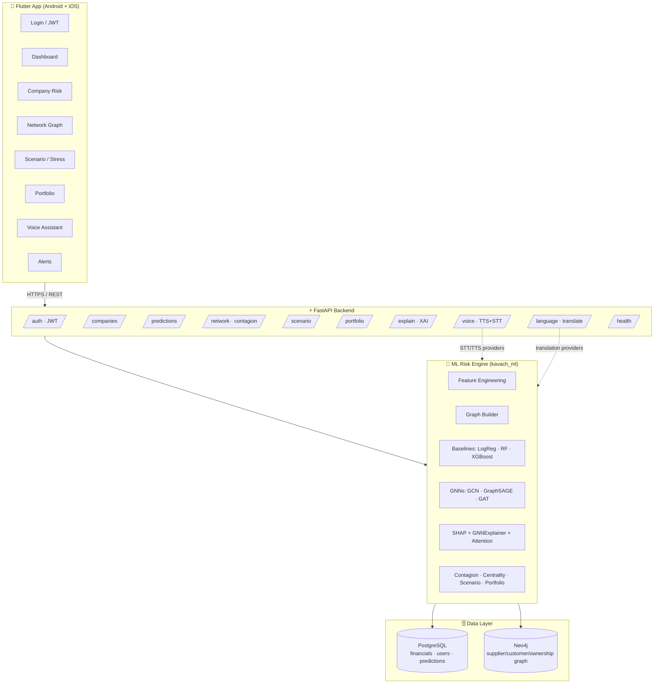
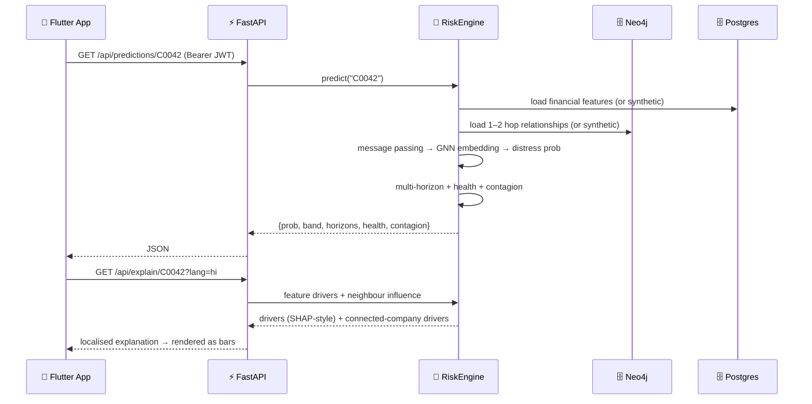

<div align="center">

# 🛡️ Kavach

### Graph Neural Network Corporate Financial Risk Intelligence Platform

*Predict corporate financial distress before it happens — by reading the network, not just the balance sheet.*


</div>

---

## 📖 Table of contents

1. [What Kavach is](#-what-kavach-is)
2. [The core idea in one picture](#-the-core-idea-in-one-picture)
3. [Why a Graph Neural Network](#-why-a-graph-neural-network-not-just-xgboost)
4. [System architecture](#-system-architecture)
5. [Complete feature set (25 modules + voice + multilingual)](#-complete-feature-set)
6. [Tech stack](#-tech-stack)
7. [End-to-end request flow](#-end-to-end-request-flow)
8. [The ML experiment & results](#-the-ml-experiment--results)
9. [Repository layout](#-repository-layout)
10. [Quick start](#-quick-start-5-minutes)
11. [API reference](#-api-reference)
12. [Deployment](#-deployment)
13. [Roadmap](#-roadmap)
14. [Honest scope & disclaimers](#-honest-scope--disclaimers)

---

## 🎯 What Kavach is

**Kavach** (Sanskrit for *shield / armour*) is a production-shaped **Corporate Financial
Risk Intelligence Platform**. It forecasts whether a company is heading toward
**financial distress** — the state before *default → restructuring → insolvency →
bankruptcy* — and, crucially, it does so by modelling the **web of relationships**
each company sits inside: its suppliers, customers, subsidiaries, lenders and
industry peers.

It is not "a GNN notebook". It is a full vertical slice:

> a **Flutter mobile app** → a **FastAPI backend** → a **Graph Neural Network** engine →
> a **Neo4j graph database** + **PostgreSQL**, with **explainable AI**, **scenario stress
> testing**, **network-contagion simulation**, a **multilingual voice assistant**, Docker
> packaging and CI/CD.

Think of it as a pocket-sized Bloomberg-style credit-risk terminal.

---

## 🖼️ The core idea in one picture

A company can look perfectly healthy on its own books and still fail — because the
supplier it depends on for 48% of its raw materials is collapsing, or its biggest
customer just defaulted. **Balance-sheet models are blind to this. Kavach is not.**

```
                        Supplier A  🔴 (distressed)
                             │ 48% of purchases
                             ▼
   Supplier B 🟢 ─────▶  COMPANY X  🟠 ◀───── Customer C 🟢
                             │
                             ▼
                       Subsidiary D 🔴 (high debt)
                             │
                             ▼
                          Bank E  (rising exposure)
```

Company X's own ratios say "fine". Its **neighbourhood** says "danger". A Graph
Neural Network passes messages along these edges, so X's risk score is informed by
everything it is connected to.

---

## 🧠 Why a Graph Neural Network (not just XGBoost)?

| | Tabular model (XGBoost / LogReg) | **Graph Neural Network (Kavach)** |
|---|---|---|
| Sees a company's own financials | ✅ | ✅ |
| Sees its suppliers' / customers' health | ❌ | ✅ (message passing) |
| Detects contagion / cascading failure | ❌ | ✅ |
| Catches a *healthy-looking* firm dragged down by its network | ❌ | ✅ |
| Explains *which connected company* drove the risk | ❌ | ✅ (attention / GNNExplainer) |

Kavach trains **both** and puts them on the same scoreboard, so the graph advantage
is measured, not asserted. See [results](#-the-ml-experiment--results).

**Message passing, plainly:** each company starts with its own feature vector; at
every GNN layer it *aggregates* its neighbours' vectors and updates its own. After a
couple of layers, each company's representation encodes its 1–2 hop financial
neighbourhood. A classifier head turns that into a distress probability.

---

## 🏛️ System architecture



**Layered, thin-controller design:** route handlers stay thin and delegate to the
`RiskEngine`, which owns all modelling and graph analytics. Postgres holds the
structured financials; Neo4j holds the relationships. The app runs **fully on a
self-contained synthetic economy** with zero external services, so you can clone and
run it in five minutes — then point it at real databases without touching the API.

---

## 🚀 Complete feature set

Kavach is built around the core GNN prediction plus **25 intelligence modules** and two
cross-cutting product pillars — **voice** and **multilingual** support.

### Core prediction
| # | Feature | What it does | Endpoint |
|---|---|---|---|
| 1 | **Financial Distress Score** | GNN probability of distress within 12 months | `GET /api/predictions/{id}` |
| 2 | **Multi-Horizon Prediction** | Separate risk at **3 / 6 / 12 / 24 months** | `.../multi-horizon` |
| 3 | **Financial Health Score** | 0–100 composite of liquidity, leverage, profitability, cash flow, growth | `.../health-score` |
| 4 | **Risk Banding** | LOW · MODERATE · HIGH · CRITICAL | every prediction |

### Fundamental risk modules
| # | Feature | Signals |
|---|---|---|
| 5 | **Liquidity Risk** | current / quick / cash ratio, working capital |
| 6 | **Leverage Risk** | debt/equity, debt/assets, interest coverage, net-debt/EBITDA |
| 7 | **Profitability Trend** | multi-year margin trajectory, not just latest |
| 8 | **Cash-Flow Risk** | OCF, FCF, cash-flow volatility, cash burn (months of runway) |
| 9 | **Revenue Growth** | YoY, 3-yr CAGR, acceleration / deceleration |
| 10 | **Anomaly Detection** | flags abrupt YoY jumps in revenue / debt / cash |

### Network / graph intelligence 🔥
| # | Feature | What it does | Endpoint |
|---|---|---|---|
| 11 | **Network Contagion Risk** | how exposed a firm is to distressed neighbours | `GET /api/network/{id}/contagion` |
| 12 | **Supplier Concentration** | Herfindahl-Hirschman index over suppliers | company detail |
| 13 | **Customer Concentration** | HHI over customers | company detail |
| 14 | **Dependency Risk** | reliance on suppliers / customers / banks / subsidiaries | company detail |
| 15 | **Centrality Risk** | PageRank + degree centrality (systemic importance) | company detail |
| 16 | **Community / Cluster Risk** | risk of the surrounding industry cluster | heatmap |
| 17 | **Industry Risk** | industry-level average risk + heatmap | `GET /api/network/heatmap` |
| 18 | **What-if Network Simulation** | propagate a supplier failure downstream (BFS + decay) | `POST /api/network/{id}/simulate-failure` |

### Product & decision-support
| # | Feature | What it does | Endpoint |
|---|---|---|---|
| 19 | **Scenario Analysis / Stress Test** | recompute risk under revenue drop / rate hike / supplier loss | `POST /api/scenario` |
| 20 | **Explainable AI** | signed feature drivers **+ which connected companies** drove the score | `GET /api/explain/{id}` |
| 21 | **Risk Timeline** | back-cast how a company's risk evolved year over year | company detail |
| 22 | **Peer Comparison** | company vs. industry average across key metrics | company detail |
| 23 | **Early-Warning System** | feed of companies that crossed into HIGH/CRITICAL | `GET /api/alerts/early-warning` |
| 24 | **Risk Heatmap** | industry-by-industry risk colour map | `GET /api/network/heatmap` |
| 25 | **Portfolio Risk** | aggregate distress exposure **+ shared-network concentration** | `POST /api/portfolio/risk` |

### 🎙️ Voice (audio) — cross-cutting pillar
- **Text-to-Speech**: risk summaries read aloud — `POST /api/voice/tts`
- **Speech-to-Text**: dictate a query — `POST /api/voice/stt`
- **Full voice loop**: *speak a question → transcribe → answer → speak the answer* — `POST /api/voice/ask`
- On-device STT/TTS in the Flutter app (`speech_to_text` + `flutter_tts`) with a
  server-side pipeline behind it. Providers are pluggable (stub / gTTS / Whisper / Azure / Google) and **degrade gracefully** so the pipeline always returns valid audio.

### 🌐 Multilingual — cross-cutting pillar
- **12 Indian languages** out of the box: English, हिन्दी, বাংলা, தமிழ், తెలుగు, मराठी, ગુજરાતી, ಕನ್ನಡ, മലയാളം, ਪੰਜਾਬੀ, ଓଡ଼ିଆ, অসমীয়া — `GET /api/language/supported`
- Translate any risk explanation / alert — `POST /api/language/translate`
- App UI localised via Flutter ARB files; explanations localised at the API.
- Provider-pluggable (builtin offline glossary / deep-translator / Azure).

---

## 🧰 Tech stack

| Layer | Technology |
|---|---|
| **Mobile** | Flutter · Dart · Provider · Dio · fl_chart · graphview · speech_to_text · flutter_tts |
| **Backend** | Python · FastAPI · Pydantic · Uvicorn · JWT (python-jose) |
| **ML core** | PyTorch · **PyTorch Geometric** · scikit-learn · XGBoost / LightGBM |
| **GNN models** | GCN · GraphSAGE · GAT |
| **Explainability** | SHAP · GNNExplainer / PGExplainer · GAT attention |
| **Graph algorithms** | PageRank · degree centrality · HHI concentration · Louvain community |
| **Databases** | PostgreSQL (financials) · Neo4j (relationships) |
| **Infra** | Docker · docker-compose · GitHub Actions CI · Render / Neo4j Aura |

---

## 🔄 End-to-end request flow

*Example: analyst opens Company X on their phone.*



---

## 📊 The ML experiment & results

The whole point is a **fair, honest experiment**: train tabular baselines and graph
models on the *same* stratified split and compare on **PR-AUC and recall** (not
accuracy — distress is the rare class).

The synthetic economy deliberately includes **network-induced distress**: companies
with *healthy fundamentals* that fail purely because their counterparties fail. These
are cases a tabular model structurally *cannot* get right.

Representative run (`python ml/scripts/quick_demo.py`, 600 companies, ~33% distress,
NumPy reference GNN so it runs anywhere):

| Model | ROC-AUC | **PR-AUC** | F1 | Precision | **Recall** |
|---|---|---|---|---|---|
| **GraphSAGE (graph)** | 0.976 | **0.948** | 0.811 | 0.682 | **1.000** |
| **GCN (graph)** | 0.977 | **0.946** | 0.789 | 0.652 | **1.000** |
| Logistic Regression (tabular) | 0.973 | 0.925 | 0.857 | 0.750 | 1.000 |
| XGBoost (tabular) | 0.908 | 0.855 | 0.758 | 0.694 | 0.833 |
| Random Forest (tabular) | 0.666 | 0.565 | 0.359 | 0.778 | 0.233 |

> **Takeaway:** the graph models top the table on PR-AUC — adding relationship
> structure measurably improves distress detection. The gap widens as
> `contagion_strength` in the synthetic config increases. Run
> `python -m kavach_ml.train --model gat` for the full **PyTorch Geometric** GCN /
> GraphSAGE / GAT training with focal loss, class weighting and early stopping.

**Handling class imbalance** (a favourite interview question): class weighting +
focal loss, threshold tuned on validation, and PR-AUC / recall as headline metrics —
never raw accuracy.

---

## 🗂️ Repository layout

```
Kavach/
├── README.md                    ← you are here
├── docs/
│   ├── ARCHITECTURE.md          ← deep architecture document (every subsystem, diagrams, Q&A)
│   └── Kavach_Architecture_Guide.pdf
├── ml/                          ← Graph ML engine
│   ├── src/kavach_ml/
│   │   ├── data/                synthetic economy · features · graph builder
│   │   ├── models/              baselines · GCN/GraphSAGE/GAT · numpy reference GNN
│   │   ├── explain/             SHAP + GNNExplainer + neighbour influence
│   │   ├── serve/engine.py      RiskEngine (all analytics used by the API)
│   │   ├── train.py evaluate.py config.py utils.py
│   ├── scripts/                 quick_demo.py · run_pipeline.py
│   └── tests/
├── backend/                     ← FastAPI service
│   ├── app/
│   │   ├── routers/             auth companies predictions network scenario
│   │   │                        portfolio alerts explain language voice ml health
│   │   ├── services/            audio_service · translation_service
│   │   ├── db/                  postgres · neo4j (optional)
│   │   ├── core/                config · security(JWT) · ml bridge
│   │   └── main.py
│   ├── Dockerfile · tests/
├── mobile/                      ← Flutter app
│   ├── lib/ (screens · widgets · services · state · l10n · theme)
│   └── pubspec.yaml
├── infra/
│   ├── postgres/init.sql
│   └── neo4j/init.cypher
├── .github/workflows/ci.yml     ← ML + backend + docker + flutter jobs
├── docker-compose.yml · render.yaml · scripts/deploy.sh
```

---

## ⚡ Quick start (5 minutes)

### 1. Run the ML pipeline (NumPy-only, runs anywhere)
```bash
cd ml
pip install numpy pandas scikit-learn
python scripts/quick_demo.py          # prints the model scoreboard
```

### 2. Run the API
```bash
cd backend
pip install -r requirements.txt
uvicorn app.main:app --reload --port 8000
# open http://localhost:8000/docs   (interactive Swagger UI)
# demo login → email: demo@kavach.ai   password: demo1234
```

### 3. Run the full stack (Postgres + Neo4j + API) with Docker
```bash
docker compose up --build
```

### 4. Run the mobile app
```bash
cd mobile
flutter pub get
flutter gen-l10n
flutter run --dart-define=KAVACH_API_BASE=http://10.0.2.2:8000   # Android emulator
```

---

## 📡 API reference

| Group | Method & path |
|---|---|
| Auth | `POST /api/auth/register` · `POST /api/auth/login` |
| Companies | `GET /api/companies` · `GET /api/companies/search?q=` · `GET /api/companies/{id}` |
| Predictions | `GET /api/predictions/{id}` · `.../multi-horizon` · `.../health-score` |
| Network | `GET /api/network/{id}/graph` · `.../contagion` · `POST .../simulate-failure` · `GET /api/network/heatmap` |
| Scenario | `POST /api/scenario` · `GET /api/scenario/{id}/sweep` |
| Portfolio | `POST /api/portfolio/risk` |
| Explain | `GET /api/explain/{id}?lang=` |
| Alerts | `GET /api/alerts/early-warning` |
| Language | `GET /api/language/supported` · `POST /api/language/translate` |
| Voice | `POST /api/voice/tts` · `POST /api/voice/stt` · `POST /api/voice/ask` |
| ML | `GET /api/ml/model-comparison` · `GET /api/ml/dataset-summary` |
| Health | `GET /api/health` |

Full interactive docs are auto-generated at **`/docs`** (Swagger) and **`/redoc`**.

---

## 🚢 Deployment

**Backend (Render, one click):** `render.yaml` provisions the Docker web service +
managed Postgres and wires a health check at `/api/health`. Point
`KAVACH_NEO4J_URI` at a free **Neo4j Aura** instance.

**Anywhere with Docker:**
```bash
./scripts/deploy.sh image                 # build kavach-api:latest
./scripts/deploy.sh push <your-registry>  # push
```

**Mobile:**
```bash
flutter build apk --release --dart-define=KAVACH_API_BASE=https://your-api.example.com
```

**CI/CD:** every push runs GitHub Actions — ML tests + model comparison, backend API
tests, backend Docker build, and Flutter analyze. See `.github/workflows/ci.yml`.

Full step-by-step deployment (including managed DB setup and env vars) is in
[`docs/ARCHITECTURE.md`](docs/ARCHITECTURE.md#18-deployment).

---

## 🗺️ Roadmap

- **Temporal GNN** — model how relationships evolve year over year (TGN / EvolveGCN)
- **Uncertainty estimation** — confidence intervals on each prediction
- **Real data connectors** — filings / credit-bureau ETL into Postgres + Neo4j
- **Model monitoring & drift detection** + automated retraining
- **Push notifications** for early-warning alerts
- **WebSocket** live risk streaming to the app

---

## ⚖️ Honest scope & disclaimers

- **Data is synthetic.** Kavach ships a realistic *generated* economy so it runs with
  zero external data. The pipeline is data-source agnostic — swap
  `generate_economy()` for a real loader and everything downstream is unchanged.
- The default in-repo run uses a **NumPy reference GNN** (SGC-style message passing)
  so the whole thing runs with only NumPy + scikit-learn. The **PyTorch Geometric**
  GCN / GraphSAGE / GAT models are the production path (`ml/models/gnn.py`,
  `ml/train.py`) and require `torch` + `torch-geometric`.
- This is a **decision-support** tool, not financial advice. Predictions are
  probabilistic and should never be the sole basis for an investment or credit
  decision.

---

<div align="center">

**Built with graphs, because companies don't fail alone.** 🛡️

</div>
