<div align="center">

# KAVACH
## Detailed System Architecture & Engineering Guide
### Graph Neural Network Corporate Financial Risk Intelligence Platform

---

*15 architecture diagrams, broken down by subsystem · ML pipeline · Graph data model ·
Voice & language pipeline · Explainability · Deployment, security & resilience ·
Rapid-fire Q&A and "claims to avoid" guardrails*

</div>

---

## Contents

1. [What Kavach Is](#1-what-kavach-is)
2. [System at a Glance — High-Level Architecture](#2-system-at-a-glance--high-level-architecture)
3. [The Core Insight — Why a Graph](#3-the-core-insight--why-a-graph)
4. [Web Client Architecture](#4-web-client-architecture)
5. [Backend / API Layer](#5-backend--api-layer)
6. [The Risk Engine — Inference & Analytics Core](#6-the-risk-engine--inference--analytics-core)
7. [ML Pipeline — Data → Features → Graph → Models](#7-ml-pipeline--data--features--graph--models)
8. [The Models — Baselines vs GCN / GraphSAGE / GAT](#8-the-models--baselines-vs-gcn--graphsage--gat)
9. [Handling Class Imbalance](#9-handling-class-imbalance)
10. [Explainable AI — Feature & Network Attribution](#10-explainable-ai--feature--network-attribution)
11. [Network Analytics — Contagion, Centrality, Simulation](#11-network-analytics--contagion-centrality-simulation)
12. [Scenario & Portfolio Intelligence](#12-scenario--portfolio-intelligence)
13. [Data Model — PostgreSQL + Neo4j](#13-data-model--postgresql--neo4j)
14. [Voice & Multilingual Pipeline](#14-voice--multilingual-pipeline)
15. [Security & Resilience](#15-security--resilience)
16. [Deployment](#16-deployment)
17. [Trade-offs & Known Weaknesses](#17-trade-offs--known-weaknesses)
18. [Interview Mental Model (Master Diagram)](#18-interview-mental-model-master-diagram)
19. [Claims to Avoid Unless Verified in Code](#19-claims-to-avoid-unless-verified-in-code)
20. [API Route Catalog](#20-api-route-catalog)
21. [Rapid-Fire Q&A](#21-rapid-fire-qa)

---

## 1. What Kavach Is

Kavach is a **Corporate Financial Risk Intelligence Platform** that predicts corporate
**financial distress** — the state that precedes *default → restructuring → insolvency →
bankruptcy* — using **Graph Neural Networks (GNNs)**. Its defining idea is that a company's
risk cannot be read from its balance sheet alone: it depends on the health of the companies
it is connected to (suppliers, customers, subsidiaries, lenders, industry peers).

### Core product capabilities
- Distress probability + risk band (LOW / MODERATE / HIGH / CRITICAL)
- Multi-horizon prediction (3 / 6 / 12 / 24 months)
- Network contagion, centrality and supplier/customer concentration analytics
- Explainable AI — feature drivers **and** which connected companies drove the score
- Scenario stress testing and supplier-failure network simulation
- Portfolio distress exposure with shared-network concentration
- Early-warning alert feed and industry risk heatmap
- Multilingual voice assistant (speak a query, hear the answer)

### Technology stack (from repository)
- **Web client:** Flutter Web + Dart, Provider state, Dio HTTP, fl_chart
- **Backend:** FastAPI (thin routers) → RiskEngine → Postgres / Neo4j
- **ML:** PyTorch + PyTorch Geometric (GCN/GraphSAGE/GAT); scikit-learn + XGBoost baselines
- **Explainability:** SHAP, GNNExplainer / PGExplainer, GAT attention
- **Data:** PostgreSQL (financials), Neo4j (relationships)
- **Infra:** Docker, docker-compose, GitHub Actions, Render / Neo4j Aura

---

## 2. System at a Glance — High-Level Architecture

Four layers, top to bottom: a **responsive Flutter web client** talks to a **FastAPI route layer**, which
delegates to a **Risk Engine** (all modelling + analytics), which reads from **PostgreSQL +
Neo4j** (or a self-contained synthetic economy in demo mode).

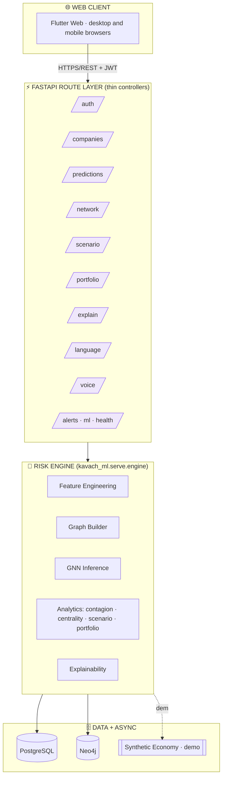

**How to narrate this:** "One web client — built with Flutter Web — talks to a FastAPI route layer grouped
by concern: auth, companies, predictions, network, scenario, portfolio, explainability,
language, voice, and ops. Route handlers stay thin and delegate to a single Risk Engine that
owns all modelling and graph analytics. The engine reads financials from Postgres and
relationships from Neo4j; in demo mode it builds a self-contained synthetic economy so the
whole system runs with zero external services."

---

## 3. The Core Insight — Why a Graph

A purely tabular model sees only one company's own numbers. It cannot see that a healthy
company's biggest supplier is collapsing. Kavach models the **economy as a graph** and uses
**message passing** so each company's prediction is informed by its neighbourhood.

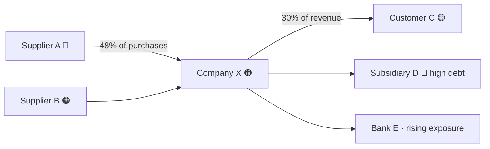

**Message passing in one paragraph:** every company starts as its own feature vector. At each
GNN layer it aggregates its neighbours' vectors and updates its own representation. After two
layers, a company's embedding encodes its 1–2 hop financial neighbourhood; a classifier head
turns that embedding into a distress probability. This is what a tabular model cannot do.

**Guardrail:** don't claim Kavach connects to live real-world supply-chain feeds. The shipped
system runs on a synthetic economy and is *designed* to accept real Postgres/Neo4j sources.

---

## 4. Web Client Architecture

The responsive Flutter web client hosts workflow modes in a desktop sidebar and compact
mobile-browser navigation. Each screen calls one or more thin API routes through a single
`ApiClient`. The production Docker image serves the compiled web client and FastAPI from
one origin; this keeps browser API calls same-origin and avoids a separate frontend service.

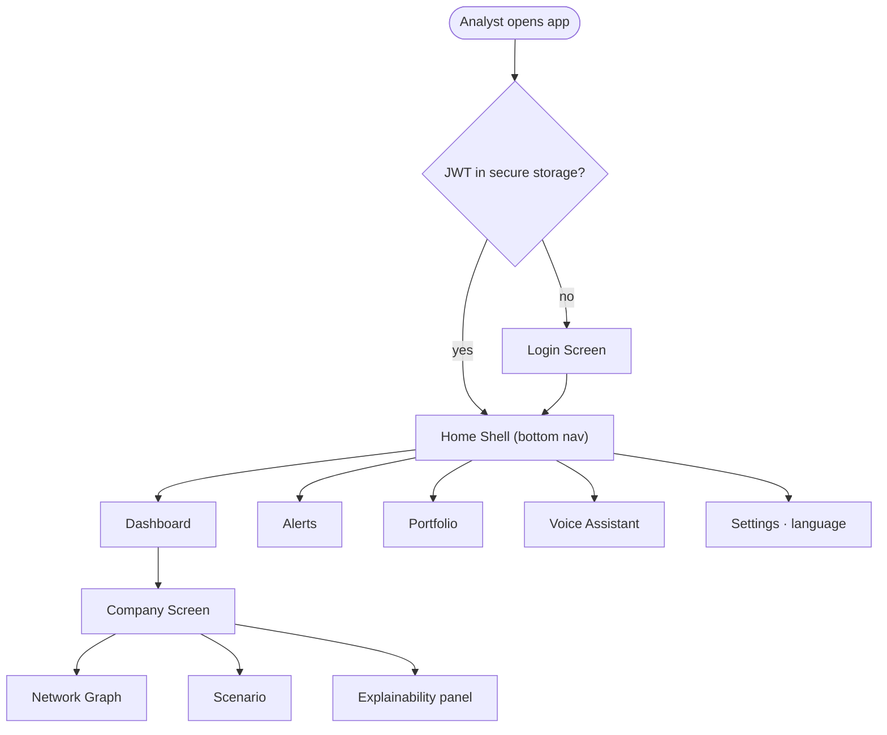

**Talking points**
- State is held in a `ChangeNotifier` (`AppState`): auth token, current user, selected locale.
- The JWT is persisted in `flutter_secure_storage`; `ApiClient` attaches it as a Bearer header.
- The network graph screen renders the ego graph with `graphview`, colouring nodes by risk band.
- Localisation uses the Flutter language tables under `mobile/lib/l10n/`; language is
  switchable at runtime from Settings.

---

## 5. Backend / API Layer

The backend is a **thin-controller** FastAPI app. Routers validate input and delegate to the
Risk Engine; they contain no modelling logic themselves.

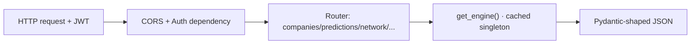

**Talking points**
- `get_engine()` is an `lru_cache` singleton — the model trains once per process and is shared.
- Auth is JWT (HS256) via `python-jose`; passwords hashed with `pbkdf2_sha256` (passlib).
- Postgres and Neo4j layers are **optional** — guarded by `is_configured()`; unset ⇒ synthetic.
- Every heavy route degrades gracefully; the API is designed to never hard-fail a request.

---

## 6. The Risk Engine — Inference & Analytics Core

`kavach_ml.serve.engine.RiskEngine` is the heart of the system. On first use it generates the
economy, builds the graph, trains the graph model, and caches predictions. Every product
feature is a method on this class.

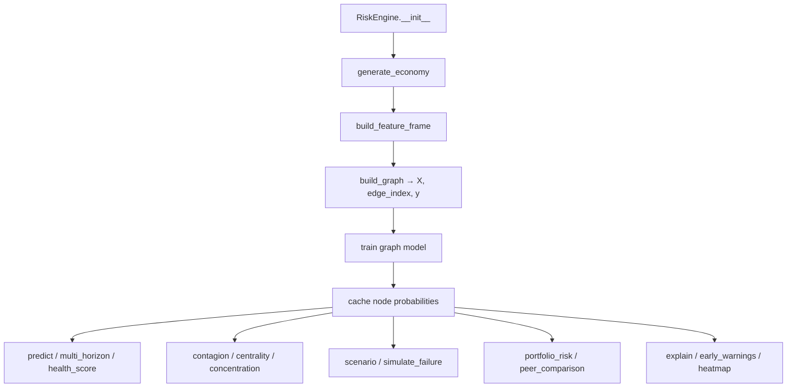

**Why one engine:** it guarantees every endpoint returns numbers consistent with the same
trained model and the same graph, and it makes swapping the data source a one-function change.

---

## 7. ML Pipeline — Data → Features → Graph → Models

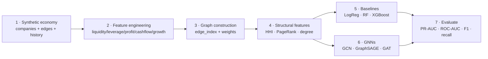

**Key design decision (leakage-free experiment):** the model's node features are a company's
**own financial ratios only**. Graph structure reaches the GNN through `edge_index` message
passing — *not* by injecting neighbour features into the tabular vector. Structural scalars
(concentration, centrality, neighbour distress) are kept separate and used only for analytics
and explainability, so the tabular-vs-graph comparison is fair.

**The synthetic economy** encodes distress as a function of (a) a company's own fundamentals
and (b) its neighbours' health, plus explicit **network-induced distress** (healthy firms that
fail because ≥2 direct counterparties fail). That last part is the signal only a graph model
can capture.

---

## 8. The Models — Baselines vs GCN / GraphSAGE / GAT

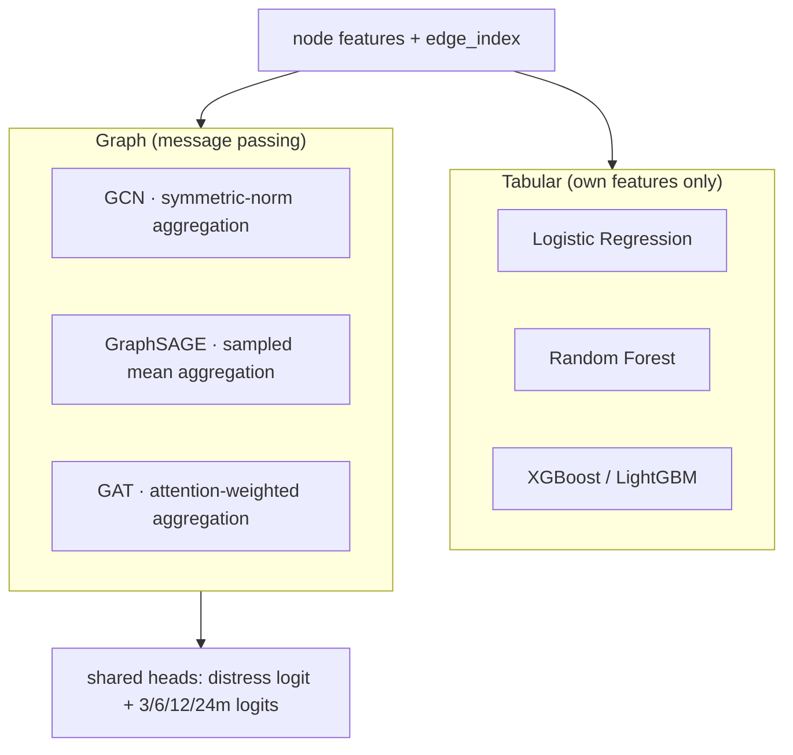

- **GCN** — each node averages its neighbours with degree normalisation. Simple, strong baseline.
- **GraphSAGE** — samples and aggregates neighbours; scales to large graphs.
- **GAT** — learns **attention weights** so a 48%-of-purchases supplier counts more than a 2%
  one. Attention doubles as an explainability signal.
- **R-GCN (relational)** — the frontier model here. Corporate edges are *not*
  interchangeable, so a plain GCN that collapses all edges into one adjacency throws away
  information. R-GCN (Schlichtkrull et al., 2018) learns a **separate transformation per
  relation type** (SUPPLIES / CUSTOMER_OF / OWNS / BORROWS_FROM / SAME_INDUSTRY) — exactly
  the `A_supply / A_equity / A_lending` decomposition of HGNN-EBP (2025). This tops Kavach's
  scoreboard on PR-AUC / KS.
- **Hybrid GNN + gradient boosting** — concatenate the learned graph embedding with the raw
  tabular features and feed a boosted tree. The 2026 relational-GNN paper finds this is the
  strongest configuration *at scale*; Kavach reproduces it and reports honestly that it needs
  a large graph to pay off.

The repo ships three implementations: the production **PyTorch Geometric** models
(`ml/models/gnn.py` — GCN/GraphSAGE/GAT/**RGCN**, trained by `ml/train.py`), a dependency-light
**NumPy reference GNN** (SGC + relational + hybrid, `ml/models/numpy_gnn.py`) so the pipeline
runs and produces the scoreboard anywhere — including CI — without a GPU, and the classic
**Altman Z-Score** (`ml/models/altman.py`) as the 1968 baseline. Every architecture is traced
to a paper in **docs/RESEARCH.md**; metrics follow the credit-risk literature (PR-AUC, KS,
recall, precision@k).

---

## 9. Handling Class Imbalance

Distress is the rare class, so **accuracy is not a headline metric** (predicting "everyone is
healthy" scores high accuracy and is useless). The pipeline uses:

- **class weighting** (inverse frequency) and **focal loss** (`focal_gamma`) on the GNN
- **threshold tuning** on the validation set (F1-optimal), not a fixed 0.5
- **PR-AUC and recall** as the metrics that lead the scoreboard
- `scale_pos_weight` for XGBoost, `class_weight="balanced"` for LogReg / RF

**Guardrail:** describe this as per-model class weighting + focal loss + threshold tuning — not
a full cost-sensitive learning framework, unless you extend it into one.

---

## 10. Explainable AI — Feature & Network Attribution

Kavach never shows a bare "78%". It answers *why*.

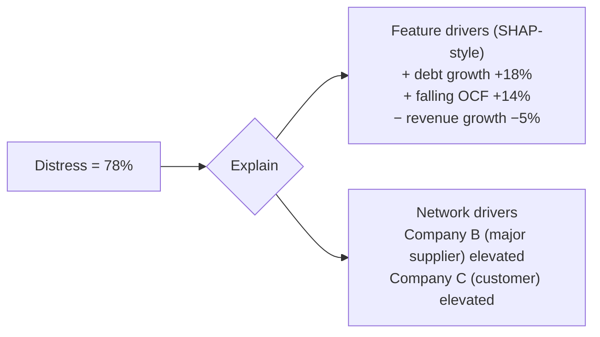

- **Tabular:** SHAP when available; a fast linear/importance attribution fallback otherwise
  (`explain/tabular.py`). Returns signed per-feature contributions and a normalised share.
- **Graph:** `explain/graph.py` ranks 1-hop neighbours by *influence = edge_weight × neighbour
  risk*, and (with a trained torch GAT) can read **attention weights** or run **GNNExplainer**.
- The API can localise driver labels via the translation service (`/api/explain/{id}?lang=hi`).

---

## 11. Network Analytics — Contagion, Centrality, Simulation

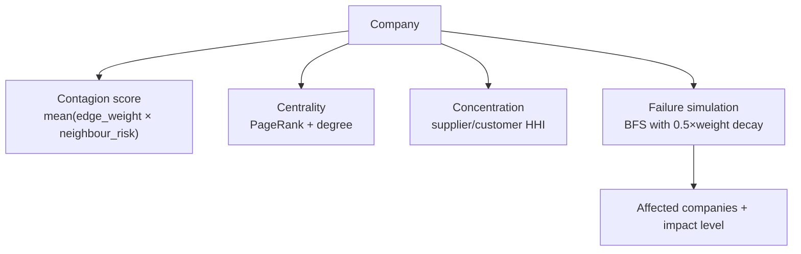

- **Contagion** — how exposed a firm is to distressed neighbours.
- **Centrality** — PageRank (computed by power iteration) + degree centrality identify
  systemically important firms whose failure would ripple widely.
- **Concentration** — Herfindahl-Hirschman Index over supplier / customer edge weights.
- **What-if simulation** — `simulate_failure` propagates a firm's collapse downstream with
  distance decay and returns the affected set + an impact level (LOW/MODERATE/HIGH).

---

## 12. Scenario & Portfolio Intelligence

**Scenario / stress test** (`scenario`): recompute risk under a revenue shock, a rate change,
and/or a supplier failure — a closed-form perturbation of the base probability, with the
supplier-failure term scaled by the firm's supplier concentration.

```
Current risk        42%
Revenue −10%        51%
Revenue −20%        67%
Revenue −30%        81%
Rates +200 bps      58%
```

**Portfolio risk** (`portfolio_risk`): weight-average the distress probabilities of holdings
into a single exposure, then surface **shared-network concentration** — e.g. "42% of your
portfolio is linked to the same high-risk supplier network." This is a graph-native insight a
per-name risk model cannot produce.

---

## 13. Data Model — PostgreSQL + Neo4j

Two stores, each for what it is best at.

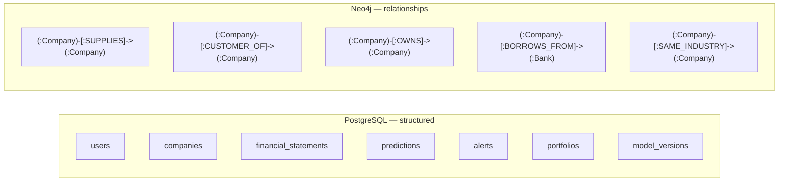

- **Postgres** holds document-flat structured data: financials, users, predictions (with
  per-horizon columns), alerts, portfolios (JSONB holdings), and a `model_versions` registry.
- **Neo4j** holds the relationship graph the GNN consumes. The 1-hop neighbourhood query
  (`MATCH (c:Company {id})-[r]-(n:Company) RETURN ...`) feeds the graph screen and the graph
  builder. Schema and constraints live in `infra/neo4j/init.cypher`.

**Guardrail:** don't claim a relational DB was "rejected because it can't scale". The honest
framing: financials are naturally tabular (Postgres), relationships are naturally a graph
(Neo4j), and using each for its strength is the design.

---

## 14. Voice & Multilingual Pipeline

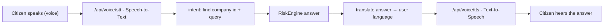

- **STT** providers: stub / Whisper / Azure / Google. **TTS** providers: stub / gTTS / Azure /
  Google. Both **degrade gracefully** — the stub returns a valid silent WAV / echo transcript
  so the pipeline is testable with no credentials.
- **`/api/voice/ask`** runs the full loop: transcribe → parse a company id → answer → translate
  → speak.
- **Multilingual:** 12 Indian languages via `/api/language/supported`; `/api/language/translate`
  localises any risk text; the web UI is localised through Flutter language tables. The translation
  service falls back builtin-glossary → passthrough so it never hard-fails.

---

## 15. Security & Resilience

- **Auth:** JWT (HS256), Bearer tokens, hashed passwords (`pbkdf2_sha256`).
- **Input validation:** Pydantic schemas on every request body; bounded query params.
- **Fail-soft design:** optional providers (audio, translation) and optional databases all
  degrade to safe defaults; the synthetic engine guarantees the API works standalone.
- **CORS** configurable via settings; secrets via environment (`.env`, never committed).
- **Health check** at `/api/health` reports DB configuration status for orchestrators.
- **Observability hooks:** structured logging dependency included; the engine is a single
  choke-point that is easy to instrument.

**Guardrail:** the shipped auth store is in-memory with a seeded demo user; describe it as a
JWT flow ready to be backed by Postgres/Firebase, not a hardened production identity system.

---

## 16. Deployment

```mermaid
flowchart LR
    SRC[Source] --> BUILD["Docker multi-stage build"]
    BUILD --> IMG[kavach-api image]
    IMG --> RUN["Render / any Docker host"]
    RUN --> HC[/api/health]
    PG[(Managed Postgres)] --> RUN
    NEO[(Neo4j Aura)] --> RUN
    IMG --> WEB["Flutter Web → same-origin web client"]
```

**Steps**
1. **Web + API image** — `backend/Dockerfile` builds the Flutter web client, installs the
   backend dependencies, copies `backend` + `ml`, and serves the client and API from one
   origin. Uvicorn exposes `/api/health` for health checks.
2. **Full local stack** — `docker compose up --build` starts Postgres + Neo4j + API with init
   scripts mounted.
3. **Managed deploy** — `render.yaml` provisions the web service + managed Postgres and
   generates the JWT secret; point `KAVACH_NEO4J_URI` at Neo4j Aura.
4. **Local web build** — `cd mobile && flutter build web --release`. In production, the
   client uses the deployment's origin for API requests; set `KAVACH_API_BASE` only when
   developing against a separately hosted backend.
5. **CI/CD** — `.github/workflows/ci.yml` runs ML tests + comparison, API tests, Docker build,
   and Flutter analyze on every push.

**Environment variables** hold DB URLs, JWT secret, provider selection and warm-up flag; see
`backend/.env.example`.

---

## 17. Trade-offs & Known Weaknesses

Being candid here is a strong engineering signal.

- The shipped default uses a **NumPy reference GNN** for portability; the full **PyTorch
  Geometric** GCN/GraphSAGE/GAT path exists but needs `torch` installed.
- **Data is synthetic.** The pipeline is data-source agnostic, but there is no real-data ETL
  in the repo yet.
- The **auth user store is in-memory**; it should be Postgres/Firebase-backed for production.
- **Scenario recomputation is a closed-form approximation**, not a full re-inference of the GNN
  under perturbed inputs — fast and demonstrative, but an approximation.
- **Contagion / failure simulation** use heuristic decay, not a calibrated cascade model.
- **No temporal modelling yet** — relationships are treated as a snapshot (temporal GNN is on
  the roadmap).
- **Retry / circuit-breaker** behaviour for external providers is per-call fallback, not a
  centralised policy.

---

## 18. Interview Mental Model (Master Diagram)

If you can explain this one diagram and zoom into any box on a follow-up, you can navigate
almost any Kavach architecture question.

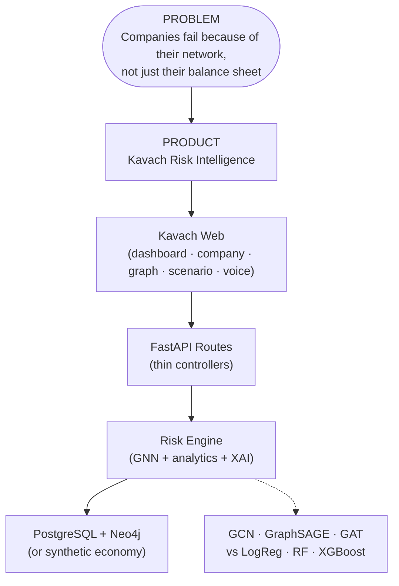

*The one line to keep in your head: problem → product → web client → API → engine → data, with graph
models as the engine's core.*

---

## 19. Claims to Avoid Unless Verified in Code

- Don't claim Kavach ingests **live real-world** supply-chain or filings data — it runs on a
  synthetic economy designed to accept real sources.
- Don't claim a relational database was **rejected because it can't scale** — the design uses
  Postgres for tabular data and Neo4j for relationships, each for its strength.
- Don't claim the **PyTorch GAT is trained by default** — the portable default is the NumPy
  reference GNN; torch training is an explicit path.
- Don't claim a **production-grade identity system** — the shipped auth is a JWT flow with a
  seeded in-memory user store.
- Don't claim **real emergency/regulatory integrations** — there are none.
- Don't invent exact accuracy figures — quote the reproducible `quick_demo.py` scoreboard and
  say numbers vary with the synthetic config seed.

---

## 20. API Route Catalog

```
Auth
  POST /api/auth/register
  POST /api/auth/login

Companies
  GET  /api/companies                 list + filter by band
  GET  /api/companies/search?q=
  GET  /api/companies/{id}            detail: health, liquidity, leverage,
                                      concentration, centrality, peers, timeline, anomalies

Predictions
  GET  /api/predictions/{id}
  GET  /api/predictions/{id}/multi-horizon
  GET  /api/predictions/{id}/health-score

Network
  GET  /api/network/{id}/graph        ego network (nodes + edges)
  GET  /api/network/{id}/contagion
  POST /api/network/{id}/simulate-failure
  GET  /api/network/heatmap

Scenario / Portfolio
  POST /api/scenario
  GET  /api/scenario/{id}/sweep
  POST /api/portfolio/risk

Explainability / Alerts
  GET  /api/explain/{id}?lang=
  GET  /api/alerts/early-warning

Language / Voice
  GET  /api/language/supported
  POST /api/language/translate
  POST /api/voice/tts
  POST /api/voice/stt
  POST /api/voice/ask

Ops
  GET  /api/ml/model-comparison
  GET  /api/ml/dataset-summary
  GET  /api/health
```

---

## 21. Rapid-Fire Q&A

**Q. In one sentence, what is Kavach?**
A. A corporate financial-distress prediction platform that uses Graph Neural Networks to model
supplier/customer/ownership/lending relationships, so a company's risk reflects the health of
its whole network — delivered as a Flutter app over a FastAPI + Postgres + Neo4j backend.

**Q. Why a GNN instead of XGBoost?**
A. Tabular models see only a company's own financials. A GNN passes messages along relationship
edges, so it captures contagion — a healthy-looking firm dragged down by a failing supplier.
We train both and show the graph model wins on PR-AUC and recall.

**Q. How do you prove the graph actually helps?**
A. Same stratified split for every model; node features are own-financials only; the graph
reaches the GNN through message passing, not injected neighbour features. The synthetic labels
include network-induced distress that tabular models structurally can't capture, and the
scoreboard shows GraphSAGE/GCN topping PR-AUC.

**Q. How do you handle class imbalance?**
A. Class weighting + focal loss on the GNN, `scale_pos_weight` for XGBoost, threshold tuned on
validation, and PR-AUC / recall as headline metrics — never raw accuracy.

**Q. What's GAT and why does it matter here?**
A. Graph Attention Network learns how much weight to give each neighbour, so a 48%-of-purchases
supplier counts more than a 2% one. Those attention weights double as an explanation of which
connected company drove the risk.

**Q. Why two databases?**
A. Financials are naturally tabular (Postgres); relationships are naturally a graph (Neo4j).
Each store does what it's best at; the 1-hop Cypher query feeds both the graph screen and the
graph builder.

**Q. How does explainability work?**
A. Two channels: SHAP-style signed feature contributions for the tabular side, and
neighbour-influence ranking (edge weight × neighbour risk) plus GAT attention / GNNExplainer
for the graph side. The app renders these as +/- driver bars.

**Q. What happens if a provider (TTS/translation/DB) is down?**
A. Everything degrades to safe defaults — stub audio, glossary/passthrough translation,
synthetic engine — so the API never hard-fails. That fail-soft design is deliberate.

**Q. What would you improve first with more time?**
A. Add a real-data ETL into Postgres/Neo4j, move auth to a Postgres/Firebase store, implement a
temporal GNN for evolving relationships, and replace the closed-form scenario with true
re-inference under perturbed inputs.

**Q. What was your specific contribution?**
A. The problem framing (network-aware distress), the end-to-end architecture, the leakage-free
graph-vs-tabular experiment design, and the full vertical slice from Flutter to GNN to Neo4j.
